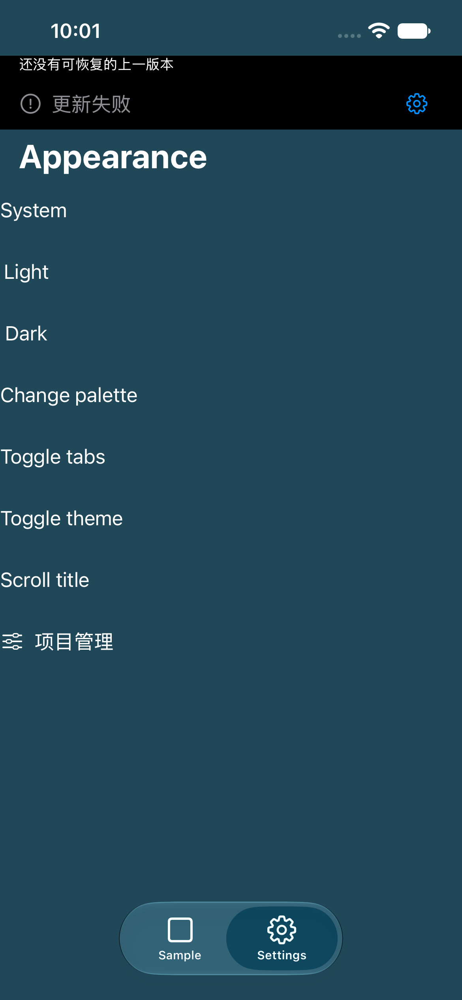
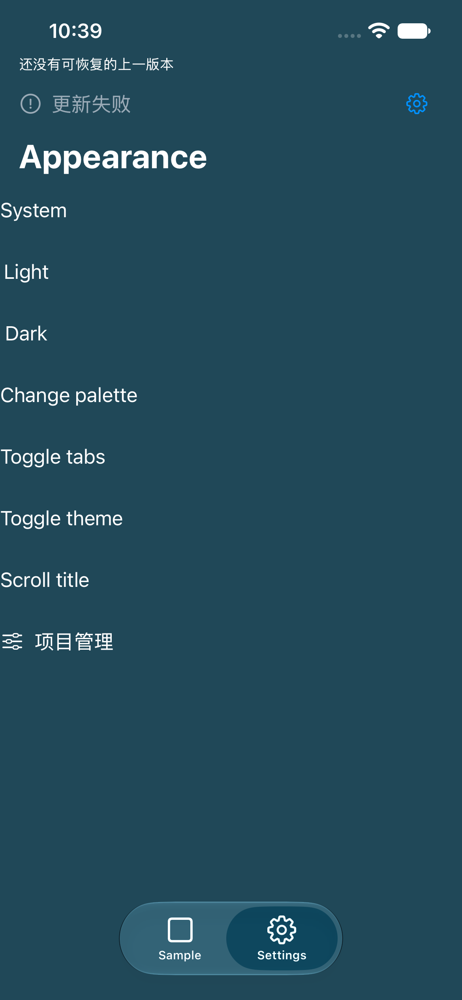

# void 原生页面顶部安全区

以下 PNG 来自 iPhone 17e、iOS 27.2、390 × 844 pt、3× 的独立模拟器，均保留原始尺寸与颜色配置。项目使用两个普通 Tab、Screen、ScrollView 和内存输入框。构建 12 的测试去掉了该版本尚未导出的项目管理按钮，各构建的 Sample 首屏相同。[两标签项目源码](https://github.com/chkf/void/tree/v0.1.0-dev.14/tests/fixtures/safe-area)

| 同一场景 | 0.1.0 (12) | 0.1.0 (13) | 0.1.0 (14) |
| --- | --- | --- | --- |
| 系统深色，Sample 稳定显示 | [全屏](12-dark-screen.png) | [全屏](13-dark-screen.png) | [全屏](14-dark-screen.png) |
| 深色，尝试恢复尚不存在的上一版本 | — | [全屏](13-dark-feedback.png) | [全屏](14-dark-feedback.png) |
| 同一提示，切换至另一套浅色 palette | — | [全屏](13-light-feedback.png) | [全屏](14-light-feedback.png) |
| 第一次绘出项目内容的深色显示刷新 | — | [应用窗口](13-first-dark-window.png) | [应用窗口](14-first-dark-window.png) |
| 第一次绘出项目内容的浅色显示刷新 | — | [应用窗口](13-first-light-window.png) | [应用窗口](14-first-light-window.png) |

| 构建 13 · 同一深色提示 | 构建 14 · 同一深色提示 |
| --- | --- |
| [](13-dark-feedback.png) | [](14-dark-feedback.png) |

**细线实验。** 构建 12 的隐藏画布高度为 0，但承载 WebKit 的行仍有 1 pt，位于窗口 y=47…48 pt。在同一窗口中只改变该 WKWebView 的 alpha，边缘由白变黑，顶部保持纯黑，下一行仍为主题色。构建 13 已把未请求的画布裁剪到零布局高度，在相同稳定帧里从状态栏到内容均为主题色。[WebKit 原样](12-webkit-visible.png) · [仅 WebKit 透明](12-webkit-transparent.png) · [构建 12 的控制实验](https://github.com/chkf/void/actions/runs/44714418882)

**顶部提示实验。** 构建 13 的首帧中，宿主占满 844 pt，顶部系统安全区为 47 pt。UIKit 标签容器及选中子控制器从 y=91 pt 开始。窗口 y=8 pt 处已经绘出项目色，y=47 和 69 pt 落在宿主提示背景中，深色为黑、浅色为白。构建 14 让这层背景直接读取 `presentingPage ?? page` 的 palette。选中子控制器第一次加载时也有了同一背景色。真实重建测试让不同主题的候选页在已提交原生树、尚未呈现的阶段等待，并检查原页面、切换后页面及失败恢复的屏幕像素。[构建 13 的双机型基线](https://github.com/chkf/void/actions/runs/44713105819) · [构建 14 的原生改动](https://github.com/chkf/void/commit/440707605d6809254e40ab69f3fb30df618bef66)

全屏图使用 `XCUIScreen.main.screenshot()`，包括系统时间、信号和电池。首帧窗口图由 CADisplayLink 在首次检测到项目内容背景时截取，可在原生日志中核对可见页面、实际 frame 和 safeAreaInsets。检查点避开文字、图标、摄像头和提示控件。颜色转换到 sRGB，每个通道允许 8 级差异。

| iPhone 17e 的 sRGB 采样 | 状态栏背景 | 安全区底边 y=47 pt | 内容背景 |
| --- | --- | --- | --- |
| 构建 12，深色稳定帧 | `#000000` | `#FFFFFF` | `#204858` |
| 构建 13，深色稳定帧 | `#204858` | `#204858` | `#204858` |
| 构建 13，深色恢复提示 | `#204858` | `#000000` | `#204858` |
| 构建 14，深色恢复提示 | `#204858` | `#204858` | `#204858` |
| 构建 13，浅色恢复提示 | `#FFE4B8` | `#FFFFFF` | `#FFE4B8` |
| 构建 14，浅色恢复提示 | `#FFE4B8` | `#FFE4B8` | `#FFE4B8` |

基线 12 为 `96499d7`，诊断提交为 `23afee5`。基线 13 为 `67b5492`，诊断提交为 `ddf3628`。这两次诊断只增加或适配了测试和运行脚本。发布提交为 `92d93bb`，标签为 `v0.1.0-dev.14`。[发布工作流](https://github.com/chkf/void/actions/runs/44718077036) · [安装与真机复查步骤](https://github.com/chkf/void/blob/v0.1.0-dev.14/docs/BUILD.md)

iPhone 17 的 Release 配置也完成了 20 项原生测试和 3 项界面测试。该机型安全区高 62 pt，整屏为 1206 × 2622 px。取窗口 x=8 pt，在 y=61、62、63、82 pt 复采深色恢复提示，各点与内容同为 `#204858`。浅色提示同为 `#FFE4B8`。[Release 测试日志](https://github.com/chkf/void/actions/runs/44718077036/job/136226465504) · [Release 原始附件](https://github.com/chkf/void/actions/runs/44718077036/artifacts/14621921477)

表中的构建 14 原图来自正式标签首次运行的 iPhone 17e，深浅色首帧与两个安全区界面用例均通过。同轮的候选页测试遇到 WebKit 首屏加载超时，导航用例遇到 XCTest 查询超时。执行时使用 Xcode 27.2，运行器配置与完整用例名称见日志。[iPhone 17e 原始测试记录](https://github.com/chkf/void/actions/runs/44718077036/job/136226465709) · [全屏附件](https://github.com/chkf/void/actions/runs/44718077036/artifacts/14621687678)

从发布标签的源码根目录可运行以下命令。

```sh
npm ci
npm test
npm run openspec -- validate --all --strict
export DEVELOPER_DIR=/Applications/Xcode_27.2.app/Contents/Developer
export VOID_IOS_SDK=27.2
VOID_LAYOUT_PROFILE=compact bash scripts/ios-build.sh native-layout
VOID_LAYOUT_PROFILE=ipad bash scripts/ios-build.sh native-layout
bash scripts/ios-build.sh release-preview
```
